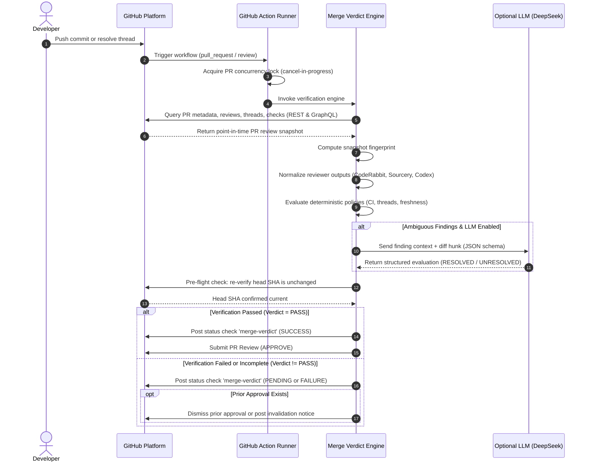

# Merge Verdict Architecture

## 1. System Overview

Merge Verdict is an automated pull request verification and approval system. It operates as an Actions-first engine that queries GitHub APIs to assess review completion, thread resolution, check runs, and reviewer freshness, then publishes a required status check and an official pull request approval review.

The architecture emphasizes:
- **Zero operational overhead**: Runs directly inside GitHub Actions without requiring an external database or persistent compute.
- **Strict decoupling**: Core verification logic is isolated in an engine library independent of the GitHub Actions runner wrapper.
- **Fail-closed deterministic execution**: Verification verdicts are computed deterministically from authoritative GitHub snapshots before any optional AI inference is consulted.

## 2. High-Level Component Architecture

The diagram below illustrates the major system components and data boundaries.

```mermaid
flowchart TD
    subgraph GitHubPlatform["GitHub Platform"]
        PREvents["PR Events\n(commits, comments, reviews)"]
        GHAPIs["GitHub APIs\n(GraphQL & REST)"]
        CheckStatus["Status Check & Review\n(merge-verdict, APPROVE)"]
    end

    subgraph TriggerLayer["Trigger & Ingestion Layer"]
        ActionWorkflow["GitHub Actions Workflow\n(.github/workflows/merge-verdict.yml)"]
        CFBridge["Optional Webhook Bridge\n(Cloudflare Worker)"]
    end

    subgraph CoreEngine["Merge Verdict Engine (TypeScript)"]
        Collector["GitHub Data Collector\n(Octokit REST & GraphQL)"]
        Normalizer["Reviewer Normalization Layer\n(Adapters for CodeRabbit, Sourcery, Codex, etc.)"]
        PolicyEngine["Deterministic Policy Engine\n(Rules, freshness, thread verification)"]
        SemanticEngine["Optional Semantic Engine\n(OpenAI-compatible SDK / DeepSeek)"]
        Publisher["Verdict & Approval Publisher\n(Checks API & Review API)"]
    end

    PREvents --> ActionWorkflow
    PREvents -.->|pull_request_review_thread| CFBridge
    CFBridge -.->|workflow_dispatch| ActionWorkflow

    ActionWorkflow --> Collector
    Collector --> GHAPIs
    GHAPIs --> Collector

    Collector --> Normalizer
    Normalizer --> PolicyEngine

    PolicyEngine -->|Ambiguous findings (optional)| SemanticEngine
    SemanticEngine -->|Semantic verdict| PolicyEngine

    PolicyEngine --> Publisher
    Publisher --> CheckStatus
```

## 3. Subsystem Breakdown and Responsibilities

### 3.1. Ingestion and Trigger Subsystem

The trigger subsystem is responsible for invoking the verification engine whenever a relevant change occurs on a pull request.

- **Primary Execution Engine**: GitHub Actions workflows running Node.js 22+.
- **Workflow Triggers**:
  - `pull_request`: `opened`, `synchronize`, `reopened`, `ready_for_review`
  - `pull_request_review`: `submitted`, `edited`, `dismissed`
  - `pull_request_review_comment`: `created`, `edited`, `deleted`
  - `issue_comment`: `created`, `edited`
  - `check_run`: `completed` (optional filter for required external checks)
  - `workflow_run`: `completed` (optional trigger on CI pipeline finish)
  - `workflow_dispatch`: Manual invocation or programmatic trigger from external bridge
- **Optional Webhook Bridge**: A serverless edge function (such as Cloudflare Worker) that listens for `pull_request_review_thread` events (`resolved`, `unresolved`), which GitHub Actions cannot trigger on natively. The bridge dispatches a `workflow_dispatch` run to the target repository.

### 3.2. GitHub Data Collector

The data collector queries the GitHub REST and GraphQL APIs to assemble a coherent point-in-time snapshot of the PR.

Responsibilities:
- Fetch PR metadata: base branch, head branch, head SHA, mergeable status, draft state, author identity.
- Query review threads via GraphQL: thread ID, resolution status (`isResolved`), resolved by user, outdated status (`isOutdated`), and thread comment history.
- Query pull request reviews: reviewer identity, state (`APPROVED`, `CHANGES_REQUESTED`, `COMMENTED`, `DISMISSED`), submission timestamp, commit SHA associated with the review.
- Query check runs and commit statuses: check names, status (`queued`, `in_progress`, `completed`), conclusion (`success`, `failure`, `neutral`, `cancelled`, `timed_out`, `skipped`), and started/completed timestamps.
- Read repository configuration file (`.github/merge-verdict.yml`) from the PR head commit (or base commit according to security policy).

### 3.3. Reviewer Normalization Layer

External review tools present findings in radically different formats. The normalization layer converts these heterogeneous outputs into strongly typed `NormalizedFinding` and `ReviewerExecutionRecord` objects.

Standardized adapter responsibilities:
- **CodeRabbit Adapter**: Parses summary comments, identifies free-tier rate limit warnings (which produce neutral check runs without actual review), extracts inline actionable findings, and filters out high-level change summaries and promotional links.
- **Sourcery Adapter**: Extracts inline review comments, maps severity badges (High, Medium, Low) to normalized severities, tracks explicit author acknowledgements (such as `Addressed in [commit]`), and recognizes bot thread resolutions.
- **Codex Adapter**: Detects machine-readable review state markers (such as `<!-- codex-review-state:v1 ... -->`), extracts target commit SHA, verification status, and unresolved finding counters.
- **DeepSeek Review Adapter**: Parses textual verdicts from workflow outputs or PR comments (e.g. `APPROVE`, `APPROVE WITH MINOR FINDINGS`, `REQUEST CHANGES`, `BLOCK`), extracts material findings and failure scenarios.
- **PR-Agent Adapter**: Parses ticket compliance analysis and review guide comments.
- **Generic Linter / Status Adapter**: Normalizes GitHub check runs (Biome, Actionlint, CodeQL, CI test suites) into uniform check assertions.

### 3.4. Deterministic Policy Engine

The core policy engine evaluates the normalized snapshot against configured rules without calling external AI models.

Responsibilities:
- **Required Check Rule**: Asserts that every configured CI check has completed with conclusion `success`.
- **Reviewer Completion Rule**: Asserts that all mandatory reviewers have posted completed reviews for the current PR snapshot.
- **Thread Resolution Rule**: Asserts that no review threads remain unresolved, or that all unresolved threads are non-blocking advisory notes according to policy.
- **Blocking Decision Rule**: Asserts that no active `CHANGES_REQUESTED` review decisions remain.
- **Freshness Rule**: Asserts that all reviewer findings and review states evaluate the current PR head SHA.
- **Atomic Pre-Flight Guard**: Computes a state fingerprint of the PR snapshot and re-verifies that the head SHA and review count have not mutated before proceeding to publication.

### 3.5. Optional Semantic Verification Engine

When deterministic rules encounter ambiguous findings (for example, a thread left unresolved where the developer pushed a commit claiming a fix, but the reviewer has not acknowledged it), the policy engine can escalate the specific finding to the semantic engine.

Characteristics:
- Communicates with any OpenAI-compatible API endpoint (such as DeepSeek).
- Receives only the isolated finding, the specific code diff hunk, and developer comments.
- Uses structured JSON outputs with strict Zod validation.
- Operates under strict token and budget limits.
- Fails closed: if the LLM output is ambiguous, malformed, or uncertain, the finding remains unresolved.

### 3.6. Verdict and Approval Publisher

The publisher translates the engine verdict into official GitHub artifacts:
- **Status Check**: Creates or updates a status check named `merge-verdict` targeting the PR `head_sha`. In Tier 1 (`GITHUB_TOKEN`), calls `POST /repos/{owner}/{repo}/statuses/{sha}`. In Tier 2 (GitHub App), calls `POST /repos/{owner}/{repo}/check-runs` with detailed Markdown summaries.
- **Pull Request Review**: When verdict is `PASS`, submits an official review (`POST /repos/{owner}/{repo}/pulls/{number}/reviews`) with event `APPROVE`. If a previously approved PR becomes `FAIL` or `STALE`, the publisher dismisses the prior approval review or posts an invalidating status update.

## 4. GitHub Actions vs. GitHub App Integration Models

Merge Verdict supports two deployment models to accommodate different repository requirements.

| Feature / Dimension          | Actions-Only (Tier 1)                                      | Actions + GitHub App Identity (Tier 2)                      |
| ---------------------------- | ---------------------------------------------------------- | ----------------------------------------------------------- |
| Infrastructure required      | None                                                       | GitHub App registration (free, self-hosted)                 |
| Authentication credential    | Runner `${{ secrets.GITHUB_TOKEN }}`                       | Dynamic token via `${{ secrets.APP_PRIVATE_KEY }}`          |
| Status Check API             | GitHub Commit Status API (`POST /statuses/{sha}`)          | GitHub Checks API (`POST /check-runs`)                      |
| Check annotations & markdown | Basic status description (up to 140 chars)                 | Full Markdown body, summary tables, inline annotations      |
| PR Approval Review           | Supported if repo allows Actions PR approval               | Fully supported under dedicated bot identity                |
| Repo settings requirement    | "Allow GitHub Actions to create and approve pull requests" | Standard repository settings; no special workflow overrides |
| Security boundary            | Bounded by workflow token permissions                      | Bounded by scoped GitHub App installation permissions       |

### Relationship Between Actions and GitHub App

It is critical to recognize that GitHub Actions and GitHub Apps are complementary:
- GitHub Actions provides the **execution runtime** (compute, triggers, runner containers).
- A GitHub App provides the **integration identity and authorization** (distinct bot user, fine-grained Checks API access, independent approval authority).

Merge Verdict operates in GitHub Actions in both models. In Tier 2, the workflow simply mints a temporary installation access token from the GitHub App credentials before executing the engine.

## 5. Data Flow and Event-to-Verdict Sequence

The sequence diagram below details the execution lifecycle from a code update to published verdict.



## 6. Architectural Alternatives Evaluated

Detailed design rationale and historical alternatives are recorded in [ADR 0001: Actions-First Hybrid Architecture](file:///Users/gordonpn/workspace/merge-verdict/docs/adr/0001-actions-first-architecture.md).

Summary of rejected approaches:
- **Standalone 24/7 Cloud Service with Database**: Rejected to avoid split-brain review state against GitHub, operational hosting costs, database migration complexity, and customer adoption friction.
- **Pure Actions Without GitHub App Support**: Rejected as sole design because default `GITHUB_TOKEN` cannot call the Checks API and requires enabling risky repo-wide Actions PR approval settings.
- **Heavy Agent Frameworks (LangChain, LangGraph, Vector DBs)**: Rejected because Merge Verdict is a deterministic policy reconciler, not a conversational agent. A lightweight OpenAI-compatible client adapter is sufficient for optional semantic evaluation.

## 7. Open Questions and Architectural Uncertainties

The following technical questions require live platform validation during early milestone implementation:

### 7.1. GitHub App Approval Satisfaction Under Branch Protection

- **Uncertainty**: While a GitHub App installation token with `pull_requests: write` can submit an `APPROVE` review, platform behavior varies based on whether branch protection requires approvals from specific Code Owners or human members, and whether "Dismiss stale approvals" cleanly dismisses App reviews upon new commits.
- **Recommended Default**: Rely on the required status check (`merge-verdict`) as the authoritative hard merge gate under branch protection, treating the PR approval review as the visible native review endorsement.
- **Validation Plan**: Execute Milestone 3 live test cases against protected branches with different branch rule permutations.

### 7.2. Zero-Comment Thread Resolution Latency

- **Uncertainty**: Because GitHub Actions does not trigger on `pull_request_review_thread`, zero-comment thread resolutions do not immediately trigger in-band workflows without the optional edge bridge. How frequently do developers resolve threads without leaving a comment or pushing a commit?
- **Recommended Default**: Start with in-band triggers in Milestone 2. Provide the Cloudflare Worker webhook relay in Milestone 4 for teams requiring instant zero-comment reaction.
- **Validation Plan**: Monitor user workflows and measure frequency of orphaned thread resolution events.

### 7.3. Handling External Reviewer Free-Tier Rate Limits

- **Uncertainty**: Tools like CodeRabbit return `conclusion: "neutral"` when repository hourly review quotas are exceeded. Should Merge Verdict treat this as `PENDING` (waiting for quota reset) or `FAIL`?
- **Recommended Default**: Treat as `PENDING` with a configurable timeout (default 30 minutes), after which it transitions to `FAIL` unless an explicit reviewer exemption is configured in `.github/merge-verdict.yml`.
- **Validation Plan**: Test with simulated rate-limited check runs in Milestone 1 and 2 fixtures.
