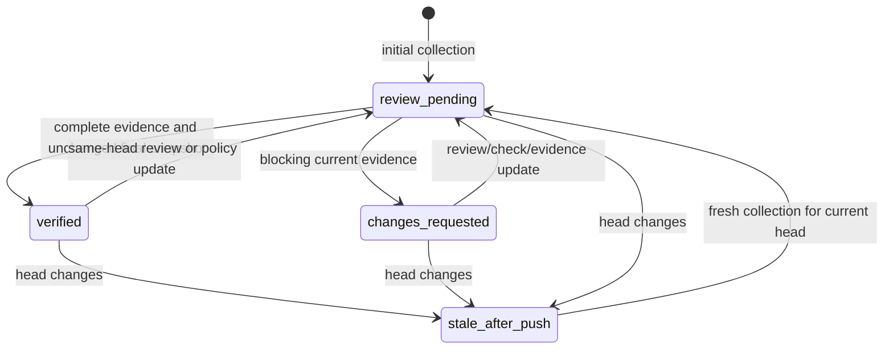

# Proposal: Commit-Scoped Approval and Verification Evidence

## Status and scope

Investigation deliverable for issue #40. This document proposes a lifecycle and evidence contract for future implementation. It does not implement an evaluator, workflow, publisher, or new schema, and does not change the accepted verification policy or ADR 0002. Any additional evidence requirements below require explicit policy review and implementation before activation.

The existing TypeScript models provide `ReviewSnapshot.headSha`, reviewer freshness and evaluated SHA, check commit SHA, finding resolution metadata, and a deterministic fingerprint of normalized records. They do not yet implement this lifecycle or a persisted verification evidence envelope. In particular, the current fingerprint does not include all raw comment IDs, update timestamps, body digests, or the protected policy revision specified by the event consistency design. A schema-valid snapshot alone is insufficient evidence for the proposed verification contract.

Verification means satisfaction of declared review and policy criteria at an observed repository state. It does not guarantee code correctness. The required `merge-verdict` check remains the authoritative automated gate; verification, approval eligibility, and GitHub recognition of that approval remain separate decisions.

## Exact-commit invariant

A verification record is valid only for its exact repository, PR, current head SHA, protected policy revision, and review-state digest. Each required check and reviewer evaluation must refer to that target SHA. Neither an ancestor result, a moving branch URL, a resolved thread, nor an earlier approval satisfies freshness for a new head.

For ordinary PR events, `evaluationSha` equals `headSha`. For a merge queue event, `evaluationSha` is the synthetic merge-group SHA and `targetKind` is `merge_group`; its passing check cannot be substituted for a PR-head evaluation or used to issue a PR approval against the synthetic commit. A PR approval requires a separate current-head assessment and the normal provider eligibility checks.

A head SHA that returns after a force-push still requires a fresh assessment of policy and review state. Records remain historical evidence, never a permanent property of a PR.

## Proposed lifecycle

These labels describe the review lifecycle, not a replacement for engine verdicts. Engine errors and races retain explicit reasons rather than being represented as successful verification.

| State               | Meaning                                                                                                                    | Engine/check representation                                                 | Approval behavior                                                               |
| ------------------- | -------------------------------------------------------------------------------------------------------------------------- | --------------------------------------------------------------------------- | ------------------------------------------------------------------------------- |
| `review-pending`    | No current complete assessment, required work is running, or evidence is missing                                           | `PENDING`: `in_progress`, conclusion `null`                                 | Withhold new approval; invalidate owned prior approval                          |
| `changes-requested` | Current blocking finding, active required-reviewer changes request, failed required check, or rejected resolution evidence | `FAIL`: `completed`, `failure` or `action_required`                         | Withhold and dismiss owned prior approval                                       |
| `verified`          | All policy predicates and evidence validation passed and final state revalidation matched                                  | `PASS`: `completed`, `success`                                              | Run configured approval provider only when eligible; record its separate result |
| `stale-after-push`  | Last evaluated head differs from observed current head                                                                     | Old evaluation is `STALE`; current head is pending until a fresh assessment | Invalidate prior approval; never transfer it to the new SHA                     |

An API, normalization, or evidence retrieval failure produces `ERROR` with a blocking conclusion and an explicit diagnostic. It does not mean the author requested changes or that code is known to be defective. A same-head fingerprint race produces `STALE` and re-evaluation, without the inaccurate `stale-after-push` label.



Diagram identifiers use underscores; displayed lifecycle labels use hyphens. On every head change, invalidation precedes the fresh collection. `stale-after-push` may be brief, but the transition and invalidated evidence IDs remain in the audit record. A new push neither clears a known concern nor proves it persists: it makes the old assessment historical and requires current evidence. Repeated events for the same observed state are idempotent.

## Proposed evidence envelope

Every completed assessment, including non-passing assessments, produces a versioned evidence record. The following is an illustrative shape, not an accepted runtime schema:

```json
{
  "schemaVersion": 1,
  "assessmentId": "assessment-123-attempt-2",
  "repository": "owner/repository",
  "pullRequestNumber": 123,
  "targetKind": "pull_request",
  "headSha": "aaaaaaaaaaaaaaaaaaaaaaaaaaaaaaaaaaaaaaaa",
  "evaluationSha": "aaaaaaaaaaaaaaaaaaaaaaaaaaaaaaaaaaaaaaaa",
  "policyVersion": "bbbbbbbbbbbbbbbbbbbbbbbbbbbbbbbbbbbbbbbb",
  "policyDigest": "sha256:<canonical-policy-content-digest>",
  "reviewStateDigest": "sha256:<canonical-source-state-digest>",
  "capturedAt": "2026-11-09T20:00:00.000Z",
  "revalidatedAt": "2026-11-09T20:00:02.000Z",
  "verifier": {
    "identity": "merge-verdict-app",
    "implementationSha": "cccccccccccccccccccccccccccccccccccccccc",
    "runId": "987654",
    "runAttempt": 2
  },
  "lifecycleState": "review-pending",
  "verdict": "PENDING",
  "requirements": [
    {
      "ruleId": "finding-resolution",
      "subjectId": "thread-42",
      "result": "missing",
      "evidenceIds": ["evidence-42"],
      "reason": "Thread is resolved but no accepted resolution evidence exists"
    }
  ],
  "evidence": [
    {
      "id": "evidence-42",
      "kind": "thread-observation",
      "sourceId": "thread-42",
      "sourceUrl": "https://github.com/owner/repository/pull/123#discussion_r42",
      "sourceActor": "author",
      "sourceUpdatedAt": "2026-11-09T19:59:00.000Z",
      "contentDigest": "sha256:<observed-thread-content-digest>",
      "evaluatedSha": "aaaaaaaaaaaaaaaaaaaaaaaaaaaaaaaaaaaaaaaa",
      "observedBy": "merge-verdict-app",
      "provenance": "author-provided",
      "claim": "conversation-resolved"
    }
  ],
  "invalidatesAssessmentIds": ["assessment-123-attempt-1"],
  "approval": {
    "provider": "none",
    "eligible": false,
    "status": "skipped_provider_none",
    "reviewIds": [],
    "countsTowardBranchProtection": "not_applicable"
  }
}
```

The placeholders for digests are explanatory, not valid hash values. Implementation must validate full commit IDs and digest formats, supported schema versions, enums, timestamps, source identifiers, and cross-record references. Approval result enums should reuse the provider contract rather than introduce competing values.

Each required predicate records its policy rule ID, subject, deterministic result (`satisfied`, `missing`, `contradictory`, or `failed`), supporting evidence IDs, and reason. Reviewer evidence records producer identity, evaluated SHA, review/run ID, state, completion time, and source update metadata. Check evidence additionally records expected application/workflow identity, status, conclusion, run attempt, and artifact references. Finding evidence records the original finding ID and commit, thread state, current resolution claim, and accepted supporting evidence IDs. A current observation of an old review does not make its evaluated SHA current.

The verifier must fetch sources through authenticated APIs and verify producer identity and commit association; it must not accept a PR comment containing a purported evidence envelope as authoritative. Author-provided claims and artifacts remain labeled by origin even when collected independently. Collection by Merge Verdict does not make their contents independently verified. Evidence cannot justify its own trust or an exemption from policy.

Source URLs for mutable GitHub conversations are locators: retain observed content digests, timestamps, and relevant normalized observations so later edits can be detected. Code/diff links use full commit SHAs. Persist the canonical evidence payload as a check attachment or workflow artifact and link it from the check report; record payload digest and retention location. Truncated output must point to the full payload. Missing, inaccessible, expired, or hash-mismatched required evidence is never silently accepted as a pass.

Canonical hashing must use explicit stable ordering, include every decision-relevant source and the protected policy revision, and exclude verifier-generated output to avoid self-invalidation. Schema versioning must make fingerprint changes explicit. On final revalidation, re-fetch the head, protected policy revision, and all mutable decision inputs; digest equality cannot compensate for incomplete API pagination or omitted inputs.

## Resolution evidence and its limits

The current policy already distinguishes thread closure from proof of a fix and exposes `require_code_evidence`. This proposal makes that distinction auditable without treating a new requirement as implemented. An implementation must define accepted evidence predicates in protected policy and map them to each actionable finding. Proposed evidence classes are:

- A current-commit acknowledgement by a policy-authorized reviewer that identifies the original finding and describes its disposition.
- A specific regression check, linked to the finding, whose trusted run on the current target SHA demonstrates the required assertion. A passing unrelated suite is insufficient.
- A policy-authorized human disposition, with identity, current SHA, reason, and finding reference, when a concern is rejected or deemed inapplicable. This is an explicit review decision, not proof of a code fix.

These are candidate predicates for review, not universal guarantees or interchangeable proofs. The implementation must specify which combinations each policy permits, including human-review requirements for sensitive paths. Semantic escalation remains optional and subject to existing fail-closed constraints; model output alone cannot redefine policy or authorize publication.

For a resolved-but-unfixed concern, closure changes the conversation observation only. If required accepted evidence is missing, remain `review-pending` with a missing-evidence reason; if current evidence demonstrates the defect or contradicts the resolution claim, use `changes-requested`/`FAIL`. An active required-reviewer `CHANGES_REQUESTED` remains blocking under existing policy even if the thread is closed. Outdated positions and author messages such as "fixed" do not satisfy either predicate. Old finding links remain visible after pushes, with historical evidence explicitly marked invalid for the current assessment.

## Invalidation, re-verification, and publication

1. Treat events as wake-up signals. Re-read the current PR and policy from the trusted base revision rather than trusting a delayed event's head. A `pull_request.synchronize` event triggers automatic invalidation and re-verification even without a new reviewer comment. Resolve review/check/comment/manual events to their PR and current head. Policy updates and same-head finding changes also invalidate the assessment.
2. Before lengthy evaluation, establish a non-passing authoritative check for the current target, mark prior evidence historical, and schedule a fresh assessment. Cancel superseded per-PR runs, but do not treat cancellation as an atomic lock. If invalidation publication fails, surface an operational error, withhold approval, and retry within bounded recovery; do not report that the remote gate was successfully closed.
3. Reconstruct snapshot and evidence from live sources. The standard native triggers cannot observe a bare thread resolution immediately; retain the optional authenticated thread-event bridge and manual re-verification path. Do not advertise instantaneous invalidation when a relevant event is not delivered. Native required-check and conversation-resolution rules remain defense in depth, with a documented event-to-invalidation network window.
4. Before each privileged write, revalidate head, policy, fingerprint, and evaluation ownership. An old run must never overwrite a newer pending or blocking check, or submit an approval after losing ownership. Follow the existing `STALE` rule: discard only when a newer owner already maintains a pending or blocking check; otherwise leave a blocking result. GitHub does not offer an atomic transaction spanning collection, check publication, and review submission.
5. Publish `success` only for a current validated `PASS`. Persist its evidence reference. Submit an eligible `APPROVE` review with `commit_id` equal to the verified PR head and an evidence link. Revalidate again between check publication and approval submission. Record provider failure separately from assessment, and never claim branch-protection recognition without verification.
6. On a new push or same-head invalidation, enumerate and dismiss active approvals owned by Merge Verdict, using recorded review IDs and ownership checks. Native stale-approval dismissal may already have done so; treat confirmed dismissal as idempotent. Never dismiss human reviews or arbitrary Copilot reviews solely because they were observed by the approval provider. Provider-managed approvals require an explicit supported invalidation authority; otherwise report that limitation and rely on the required gate.
7. Re-read after an approval write to detect a concurrent push or review mutation. If stale, block the authoritative gate and dismiss the just-created owned review. A dismissal permission/API failure remains an outstanding recovery action with review ID and reason; it does not restore verification or justify retrying approval. Retry cleanup independently so a newer run can still collect evidence. Native stale-approval rules reduce this residual window but do not replace revalidation.

Re-running collection and evaluation is automatic; requesting another external reviewer execution is a distinct operation that may need provider support, rate-limit handling, and policy permissions. Until fresh required results exist, keep the assessment pending. No push should synthesize a reviewer approval from prior results.

## Affected implementation surfaces and follow-up work

| Surface                          | Proposed implementation work                                                                                                                | Existing delivery dependency                        |
| -------------------------------- | ------------------------------------------------------------------------------------------------------------------------------------------- | --------------------------------------------------- |
| Collector and raw snapshot       | Complete paginated observations, protected policy binding, stable IDs and mutable-source digests                                            | Collector hardening and policy isolation (#23, #24) |
| Domain models                    | Versioned evidence envelope, requirement results, historical links, approval ownership, explicit lifecycle projection                       | Domain schemas exist; new schema work required      |
| Normalizers and policy evaluator | Preserve provenance/current commit, distinguish closure from accepted evidence, deterministic missing/contradictory handling                | Normalizers #10; evaluator #11; risk tiers #35      |
| Action and events                | Early invalidation, current-head lookup, bounded automatic re-evaluation, attempt ownership and cancellation handling                       | Action entry point #13; thread relay #5             |
| Publisher and providers          | Commit-bound check/evidence, preflight and post-write checks, owned-review cleanup and recovery                                             | Publisher #14; providers #36                        |
| Check report/status output       | Display lifecycle, engine verdict, current/evaluated SHA, policy revision, evidence gaps, historical assessments, provider/dismissal status | Rich report #28                                     |
| Test fixtures                    | Versioned source/evidence examples and deterministic transition/race replay cases below                                                     | Replay suite #12                                    |

The report should say, for example, "Current head B; previous verification A invalidated; waiting for reviewer X on B". `verified` must not imply an approval was submitted or that merging is unblocked. Show last successful assessment separately from current state.

Before implementation, review the evidence predicates, persistence/retention policy, ownership mechanism, and provider invalidation permissions in version control. The evidence work overlaps issues #38 and #39; this lifecycle should reuse their eventual traceability model. A check-ownership design must document API limits and residual races rather than claim atomicity from workflow concurrency alone.

## Acceptance test outline

These are proposed implementation tests, not tests run by this documentation change. Use fixed SHAs A/B, controlled API responses, and an explicit clock; assert API writes as well as returned states.

| Scenario                                                                                   | Expected observable result                                                                                                    |
| ------------------------------------------------------------------------------------------ | ----------------------------------------------------------------------------------------------------------------------------- |
| Initial PR, required reviewer absent                                                       | `review-pending`/`PENDING`; check in progress with null conclusion; missing reviewer evidence; no approval request            |
| Current reviewer requests changes                                                          | `changes-requested`/`FAIL`; blocking check; review/finding evidence IDs appear in report                                      |
| All current checks/reviews and policy evidence satisfied                                   | Final state re-read matches; `verified`/`PASS`; success and persisted evidence for A; eligible approval pins A                |
| Verification passes but risk policy requires human review or provider is `none`            | Assessment and eligibility remain separate; no automated approval; no claim that required human review is satisfied           |
| Thread marked resolved while reproducer still fails                                        | Resolution observation retained; `changes-requested`/`FAIL`; no approval                                                      |
| Thread resolved with only author "fixed" claim or unrelated passing tests                  | Required resolution evidence missing; `review-pending`; author provenance retained; no inferred fix                           |
| Resolved thread with active `CHANGES_REQUESTED`                                            | Remains `FAIL` until policy-authorized supersession/dismissal; closure does not clear review decision                         |
| Push B after verification of A                                                             | Fast invalidation and owned-review cleanup; historical A evidence retained; current B pending; automatic evaluation scheduled |
| A evidence reused for B, or force-push back to A                                           | Evidence mismatch rejected; fresh policy/snapshot evaluation required; no replayed success                                    |
| Push occurs during collection or between success and approval                              | Old run becomes `STALE`; no approval for B based on A; newer blocking/pending owner is preserved                              |
| Push immediately after approval API succeeds                                               | Post-write read detects B; blocks current gate; dismisses recorded owned A review or reports cleanup failure                  |
| New same-head blocking comment or edited evidence                                          | Fingerprint changes despite same SHA; prior result invalidated; blocking finding produces `FAIL`                              |
| Delayed/duplicate event for A arrives after B                                              | Live B state wins; no rollback of target or duplicate approval/cleanup; superseded run cannot overwrite current check         |
| API/evidence retrieval fails, pagination incomplete, artifact expired, or digest disagrees | Explicit `ERROR`, missing, or contradictory diagnostic as applicable; no `PASS`, `neutral`, or `skipped` publication          |
| Approval dismissal fails or review belongs to a human                                      | Required gate remains non-passing; failure is visible/retryable; no unauthorized dismissal                                    |
| Merge group evaluates synthetic SHA M                                                      | Check/evidence target M; PR-head evidence is not substituted; no PR approval pinned to M                                      |

For each transition fixture, assert policy revision, source identities, provenance, evidence links, invalidated assessment IDs, and that unchanged input produces the same deterministic decision. Separately test artifact size/retention failures and schema compatibility before adopting the envelope.
