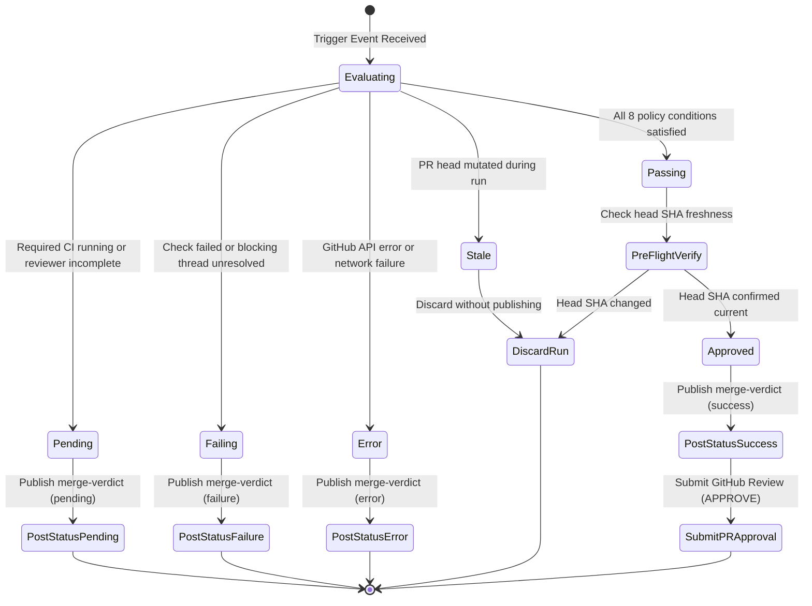

# Events, Concurrency, and State Management

## 1. Event Ingestion and Platform Coverage

To maintain an up-to-date verification verdict, Merge Verdict must react to changes in pull request code, automated review feedback, conversation threads, and CI checks.

However, GitHub Actions and GitHub Webhooks do not have identical event coverage. This section specifies supported native workflow triggers and the fallback architecture for unsupported events.

### 1.1. Native GitHub Actions Event Triggers

The following events are directly supported by GitHub Actions workflows and will trigger the Merge Verdict verification workflow:

| Lifecycle Event | Workflow Trigger Configuration | Trigger Payload Details |
|---|---|---|
| PR opened, updated, reopened | `pull_request: [opened, synchronize, reopened, ready_for_review]` | Provides target `pull_request.head.sha`. |
| PR review submitted, edited, dismissed | `pull_request_review: [submitted, edited, dismissed]` | Contains reviewer identity, state (`APPROVED`, `CHANGES_REQUESTED`), and commit ID. |
| Inline review comment created, edited, deleted | `pull_request_review_comment: [created, edited, deleted]` | Contains comment body and diff position. |
| PR conversation comment created, edited | `issue_comment: [created, edited]` | Captures bot summary comments and developer commands. |
| External CI check run completed | `check_run: [completed]` | Fires when third-party tools (e.g. CodeRabbit, CodeQL) complete a check run. |
| CI workflow completed | `workflow_run: [completed]` | Fires when a specific parent workflow (e.g. `ci.yml`) finishes. |
| Manual or dispatch trigger | `workflow_dispatch`, `repository_dispatch` | Enables manual re-verification or bridge-initiated verification. |

### 1.2. The Thread-Resolution Gap: `pull_request_review_thread`

**Verified Platform Limitation**: GitHub Webhooks includes a `pull_request_review_thread` event (with actions `resolved` and `unresolved`), which fires whenever a developer or bot clicks "Resolve conversation" or "Unresolve conversation" on an inline comment thread.

However, **GitHub Actions does not support `pull_request_review_thread` as an `on:` workflow trigger**. If included in a workflow YAML, GitHub Actions will fail to parse or ignore the event.

#### Architectural Solutions for Thread Resolution

Merge Verdict addresses this platform constraint using a tiered strategy:

1. **Standard In-Band Triggers (Default)**: In typical workflows, resolving a review thread is accompanied by a code commit (which fires `pull_request: synchronize`) or an explanatory comment (which fires `pull_request_review_comment: created`). These native triggers execute Merge Verdict without additional infrastructure.
2. **Optional Edge Webhook Bridge (High-Fidelity Mode)**: For repositories requiring instant re-evaluation upon zero-comment thread resolution:
   - A lightweight, stateless serverless worker (such as a Cloudflare Worker) is registered as a GitHub App webhook endpoint.
   - The worker verifies the GitHub webhook signature (`X-Hub-Signature-256`).
   - When a `pull_request_review_thread` event is received, the worker calls the GitHub API (`POST /repos/{owner}/{repo}/actions/workflows/merge-verdict.yml/dispatches`) with the target PR number.
   - The worker performs no business logic or state storage; it functions strictly as an event forwarding relay.

## 2. Concurrency Control and Event Storms

Automated code reviewers often emit multiple comments and check updates in rapid bursts. For example, a single reviewer run might generate 10 inline comments and a summary comment within 30 seconds.

Without concurrency protection, this generates 11 concurrent workflow executions, wasting Actions minutes and causing database/API race conditions.

### 2.1. Actions Concurrency Groups

Merge Verdict mandates concurrency groups with active cancellation in workflow definitions:

```yaml
concurrency:
  group: merge-verdict-${{ github.event.pull_request.number || github.event.issue.number || github.ref }}
  cancel-in-progress: true
```

**Behavior**:
- Workflows are isolated per pull request.
- When a new event arrives for a PR, any currently running verification workflow for that PR is immediately cancelled.
- Only the latest evaluation run executes to completion.

### 2.2. Self-Triggering Loop Prevention

Because Merge Verdict publishes status checks, check runs, and PR review submissions, it can inadvertently trigger its own workflows if events are not strictly filtered.

**Mandatory Guard Rules**:
1. **Actor Filtering**: Workflows must ignore events authored by the bot identity:
   ```yaml
   if: |
     github.actor != 'merge-verdict[bot]' &&
     github.actor != 'github-actions[bot]' &&
     github.actor != 'dependabot[bot]'
   ```
2. **Review Self-Exclusion**: When processing review events (`pull_request_review`), the engine checks `review.user.login`. If the review was authored by the active Merge Verdict bot identity, processing terminates immediately with exit code 0.
3. **Status Check Name Exclusion**: When responding to `check_run` events, the engine ignores check runs named `merge-verdict`.

## 3. Snapshot Consistency and Race Condition Handling

A passing status check or approval review is valid only if the PR state remains unchanged throughout the evaluation window. If a developer pushes a new commit while Merge Verdict is computing its policy, publishing a success verdict would approve code that was never analyzed.

### 3.1. Verification Snapshot Definition

At invocation start (T0), the engine captures a **Verification Snapshot** comprising:
- Target repository and PR number.
- Authoritative PR head commit SHA (`head_sha`).
- Total review thread count and array of thread IDs with their boolean `isResolved` values.
- Array of review submissions with their states and associated commit SHAs.
- Array of required check runs with their completed conclusions.

From this snapshot, the engine computes a deterministic **State Fingerprint**:
```text
state_fingerprint = SHA256(head_sha + ":" + sorted_threads + ":" + sorted_reviews + ":" + sorted_checks)
```

### 3.2. Pre-Publication Atomic Check

Immediately prior to publishing the status check or submitting the `APPROVE` review (T1):
1. The engine queries GitHub API for the latest `pull_request.head.sha` and the current review count.
2. If `current_head_sha !== snapshot.head_sha`:
   - A race condition occurred (new commit pushed).
   - The engine aborts publication immediately and exits with status `STALE`.
3. If new review comments or thread modifications are detected:
   - The engine aborts publication and schedules a fresh re-evaluation.

## 4. State Transitions and Verdict Lifecycle

The diagram below outlines the state machine governing Merge Verdict outcomes.



## 5. Invalidation and Recovery from Partial Failures

### 5.1. Handling Post-Approval Invalidation

If Merge Verdict previously submitted an `APPROVE` review on commit `SHA-A`, and subsequent events occur on the PR:
- **New Commit Pushed (`SHA-B`)**:
  - The status check `merge-verdict` on `SHA-B` defaults to `pending` until verified.
  - If the repository has configured GitHub branch protection to "Dismiss stale pull request approvals when new commits are pushed", GitHub automatically dismisses the approval.
  - If GitHub stale approval dismissal is not enabled at the repo level, Merge Verdict can explicitly call the GitHub API (`PUT /repos/{owner}/{repo}/pulls/{number}/reviews/{review_id}/dismissals`) with message: "Invalidated by new commit SHA-B."
- **Thread Reopened or Blocking Comment Added on Same Commit**:
  - Merge Verdict immediately updates the commit status on `SHA-A` from `success` to `failure`.
  - The engine dismisses its prior approval review.

### 5.2. Partial Failure Recovery

If the status check publication succeeds (`POST /statuses/{sha}`) but the subsequent PR review approval submission fails (e.g. temporary secondary rate limit or GitHub review API error):
1. The engine records a non-fatal error log.
2. Because the required status check `merge-verdict` is the authoritative gating mechanism under branch protection, merging remains protected.
3. The workflow exits with exit code 1, which causes GitHub Actions to flag the run as failed, allowing standard retry mechanics to re-attempt approval submission.
